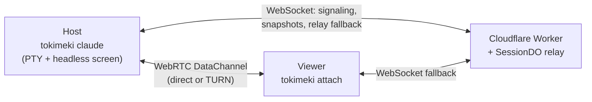

<div align="center">
  
  <h1>tokimeki</h1>
  <p><strong>Share a live terminal session across machines — without screen sharing.</strong></p>
  <p>Host Claude Code, pi, or any TUI program in a PTY. Attach from another machine over WebRTC P2P, TURN, or a Cloudflare relay fallback.</p>

  [](https://www.npmjs.com/package/@limccn/tokimeki)
  [](LICENSE)
  [](https://nodejs.org/)
  [](https://github.com/limccn/tokimeki/actions/workflows/ci.yml)
  [](https://github.com/limccn/tokimeki)

  [](https://deploy.workers.cloudflare.com/?url=https://github.com/limccn/tokimeki)

  [Deploy relay to Cloudflare](https://deploy.workers.cloudflare.com/?url=https://github.com/limccn/tokimeki) · [CLI docs](docs/cli.md) · [中文](README.zh-CN.md)
</div>

---

## What is tokimeki?

tokimeki lets one machine **host** a terminal program and another machine
**attach** to the same live session. It is built for long-running TUI tools:
the host keeps the PTY alive, viewers see the screen, and everyone shares
keyboard control.

- **No screen sharing / remote desktop.** Only terminal bytes move.
- **P2P first, relay always there.** WebRTC DataChannel (direct), coturn TURN,
  Cloudflare TURN, then a Cloudflare Worker WebSocket relay.
- **Self-hostable.** Deploy the relay to your own Cloudflare account.
- **Reconnect-friendly.** Snapshots and sequence numbers restore the screen
  after a viewer drops.
- **Multi-viewer.** Several viewers can attach; input is shared, and the host
  keeps a fixed TUI window so a new viewer never resizes the hosted program.
  Viewers letterbox or cursor-follow the fixed grid in their own terminal.
- **Any TUI command.** Add its executable name to `TOKIMEKI_WINDOW_TUI` and run
  `tokimeki <command>` (for example `TOKIMEKI_WINDOW_TUI=claude,pi,omp` then
  `tokimeki omp`). Unknown commands are rejected unless allow-listed.
- **Share again.** In the host viewport, press F12 to reopen the viewer config
  after the startup banner scrolls away; `c` copies the exact JSON. The config
  can be passed to the viewer as `TOKIMEKI_CONFIG`.

## How it works



The relay authenticates sessions, forwards control/signaling, and carries
terminal data when P2P is unavailable. Deep protocol/architecture notes live
in [`CLAUDE.md`](CLAUDE.md) and [`docs/protocol.md`](docs/protocol.md).

## Install

Requires Node.js >= 22.12.

```bash
npm install -g @limccn/tokimeki
tokimeki --version
```

Or run it without a global install:

```bash
npx @limccn/tokimeki --help
```

## Quick start

### 1. Deploy the relay

[](https://deploy.workers.cloudflare.com/?url=https://github.com/limccn/tokimeki)

Use the button above, or deploy from this repo:

```bash
git clone https://github.com/limccn/tokimeki.git
cd tokimeki
npm install
npm run deploy
```

Set the required Worker secret in the Cloudflare dashboard (or with
`wrangler secret put TOKIMEKI_MASTER_TOKEN`). Generate a strong value:

```bash
openssl rand -base64 32
```

The relay URL will be `https://<worker-name>.<your-subdomain>.workers.dev`
(`wss://...` for the CLI). See [Cloudflare deploy](docs/deploy-cloudflare.md)
for custom domains, coturn, and Cloudflare TURN.

### 2. Host a session

```bash
export TOKIMEKI_RELAY_URL=wss://<your-relay>
export TOKIMEKI_MASTER_TOKEN=<relay-master-token>

tokimeki claude
# or: tokimeki pi
# or: tokimeki run -- <your-tui-command>
```

The host prints the **session name** and a **session token**. Share those with
the viewer — never share the relay master token.

### 3. Attach from another machine

```bash
export TOKIMEKI_RELAY_URL=wss://<your-relay>
export TOKIMEKI_SESSION=<session-name>
export TOKIMEKI_SESSION_TOKEN=<session-token>

tokimeki attach
```

`tokimeki doctor` checks the local PTY and relay configuration.

## CLI at a glance

| Command | What it does |
|---|---|
| `tokimeki claude [args...]` | Host Claude Code in a PTY |
| `tokimeki pi [args...]` | Host pi in a PTY |
| `tokimeki run -- <cmd...>` | Host any TUI/terminal program |
| `tokimeki attach` | Attach to a hosted session |
| `tokimeki doctor` | Check PTY, config, and relay connectivity |

Full command/env reference: [docs/cli.md](docs/cli.md).

## Deploying with TURN

The relay can hand out STUN/TURN credentials. Start with the default
STUN-only/Worker-relay path; add TURN when you need better connectivity.

| `TOKIMEKI_TURN_PROVIDER` | What it uses |
|---|---|
| `auto` (default) | coturn REST if configured, else static TURN, else Cloudflare TURN, else STUN-only |
| `coturn` | Your coturn server(s); set `TOKIMEKI_COTURN_URLS` + secret |
| `cloudflare` | Cloudflare Realtime TURN; set Key ID + API token |
| `none` | STUN only; Worker relay is the fallback |

TURN variables, secrets, and a one-click vs manual walkthrough:
[docs/deploy-cloudflare.md](docs/deploy-cloudflare.md). The CLI uses TURN UDP
(libjuice), so include a `turn:...?transport=udp` URL.

## Configuration

All runtime configuration is environment-based. See:

- [`.env.example`](.env.example) — complete reference, including reserved
  `TOKIMEKI_*` variables.
- [docs/cli.md](docs/cli.md) — host/attach command and variable guide.
- [docs/deploy-cloudflare.md](docs/deploy-cloudflare.md) — relay vars/secrets.

Common host/attach variables: `TOKIMEKI_RELAY_URL`, `TOKIMEKI_MASTER_TOKEN`
(host only), `TOKIMEKI_SESSION`, `TOKIMEKI_SESSION_TOKEN`,
`TOKIMEKI_P2P` (`auto|off`), `TOKIMEKI_ICE_TRANSPORT_POLICY` (`all|relay`).

## Security & privacy

- Tokens are sent in headers, never in URLs; the relay master token is only
  for hosts.
- The relay can see terminal bytes while carrying them. P2P/TURN change the
  transport path; they are not a claim of end-to-end encryption.
- Use a dedicated relay/session and rotate the master token if it leaks.
- Report vulnerabilities via [SECURITY.md](SECURITY.md), not public issues.

## Documentation

- [CLI usage](docs/cli.md)
- [Cloudflare relay deploy + TURN](docs/deploy-cloudflare.md)
- [Wire protocol](docs/protocol.md)
- [Production deployment notes](docs/deployment.md)
- [Technical guide for AI assistants](CLAUDE.md)
- [Performance baselines](docs/perf/)
- [Release guide](docs/release.md)

## Status

`0.1.2` — current release. Install from
[npm](https://www.npmjs.com/package/@limccn/tokimeki) (also mirrored to GitHub
Packages; see [docs/release.md](docs/release.md)) or read the
[v0.1.2 release notes](https://github.com/limccn/tokimeki/releases/tag/v0.1.2).
P2P direct is best-effort; TURN or the Worker relay is the reliable fallback.
See [CHANGELOG.md](CHANGELOG.md) and [`CLAUDE.md`](CLAUDE.md) for known
limitations and the v1.1 feature history.

## Contributing

Issues and PRs are welcome. Start with [CONTRIBUTING.md](CONTRIBUTING.md) and
[CODE_OF_CONDUCT.md](CODE_OF_CONDUCT.md).

## License

Apache License 2.0 — see [LICENSE](LICENSE).
