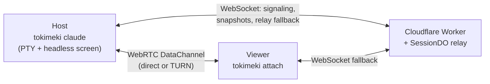

<div align="center">
  
  <h1>tokimeki</h1>
  <p><strong>Share a live terminal session across machines — without screen sharing.</strong></p>
  <p>Host Claude Code, pi, or any TUI program in a PTY. Attach from another machine over WebRTC P2P, TURN, or a Cloudflare relay fallback.</p>

  [](https://www.npmjs.com/package/@limccn/tokimeki)
  [](LICENSE)
  [](https://nodejs.org/)
  [](https://github.com/limccn/tokimeki/actions/workflows/ci.yml)
  [](https://github.com/limccn/tokimeki)

  [](https://deploy.workers.cloudflare.com/?url=https://github.com/limccn/tokimeki)

  [Deploy relay to Cloudflare](https://deploy.workers.cloudflare.com/?url=https://github.com/limccn/tokimeki) · [CLI docs](docs/cli.md) · [中文](README.zh-CN.md)
</div>

---

## What is tokimeki?

tokimeki lets one machine **host** a terminal program and another machine
**attach** to the same live session. It is built for long-running TUI tools:
the host keeps the PTY alive, viewers see the screen, and everyone shares
keyboard control.

- **No screen sharing / remote desktop.** Only terminal bytes move.
- **P2P first, relay always there.** WebRTC DataChannel (direct), coturn TURN,
  Cloudflare TURN, then a Cloudflare Worker WebSocket relay.
- **Self-hostable.** Deploy the relay to your own Cloudflare account.
- **Reconnect-friendly.** Snapshots and sequence numbers restore the screen
  after a viewer drops.
- **Multi-viewer.** Several viewers can attach; input is shared, and the host
  keeps a fixed TUI window so a new viewer never resizes the hosted program.
  Viewers letterbox or cursor-follow the fixed grid in their own terminal.
- **Read-only listeners.** `tokimeki attach --listen` watches without keyboard
  control, ACKs, resizing, or P2P; the host sends periodic full snapshots.
- **Optional P2P tunnel.** `TOKIMEKI_TUNNEL=auto` adds AES-256-GCM and
  selective-repeat ARQ over an unreliable DataChannel, with optional XOR
  parity (`TOKIMEKI_TUNNEL_FEC=xor`); failures fall back to the relay.
- **P2P resilience.** Fragmented P2P snapshots, direct snapshot delivery with
  relay fallback, automatic ICE refresh, and one TURN-provider retry.
- **ACP catalog.** Claude Code, pi, Codex, Gemini, Cursor, Aider, OpenCode,
  Goose, and Amp are allow-listed by default (`tokimeki codex`), with
  `tokimeki acp list [--detect]` and `tokimeki run -- <cmd>` as the escape
  hatch. Detection is read-only PATH scanning; no binary is executed.
- **Guided onboarding.** doctor-first host/attach wizards, TokiAPI anonymous
  host, `--config tokimeki-config.json`, `tokimeki attach <share-url>`,
  `~/.tokimeki/config.json`/history (explicit save, 0600), and daemon-mode
  structured events for harnesses.
- **F12 connection menu.** Host status/session/token (masked), viewer-config
  copy, anonymous invite URL (memory only), reconnect/disconnect, host-side
  window resize, and an F11 full-screen log view. The viewer config can still
  be passed as `TOKIMEKI_CONFIG`.

## How it works



The relay authenticates sessions, forwards control/signaling, and carries
terminal data when P2P is unavailable. Deep protocol/architecture notes live
in [`CLAUDE.md`](CLAUDE.md) and [`docs/protocol.md`](docs/protocol.md).

## Install

Requires Node.js >= 22.12.

```bash
npm install -g @limccn/tokimeki
tokimeki --version
```

Or run it without a global install:

```bash
npx @limccn/tokimeki --help
```

## Quick start

### 1. Deploy the relay

[](https://deploy.workers.cloudflare.com/?url=https://github.com/limccn/tokimeki)

Use the button above, or deploy from this repo:

```bash
git clone https://github.com/limccn/tokimeki.git
cd tokimeki
npm install
npm run deploy
```

Set the required Worker secret in the Cloudflare dashboard (or with
`wrangler secret put TOKIMEKI_MASTER_TOKEN`). Generate a strong value:

```bash
openssl rand -base64 32
```

The relay URL will be `https://<worker-name>.<your-subdomain>.workers.dev`
(`wss://...` for the CLI). See [Cloudflare deploy](docs/deploy-cloudflare.md)
for custom domains, namespace tokens, Host JWT verification, coturn, and
Cloudflare TURN.

### 2. Host a session

```bash
export TOKIMEKI_RELAY_URL=wss://<your-relay>
export TOKIMEKI_MASTER_TOKEN=<relay-master-token>

tokimeki claude
# or: tokimeki pi
# or: tokimeki run -- <your-tui-command>
```

The host prints the **session name** and a **session token**. Share those with
the viewer — never share the relay master token. For shared relays, hosts use
`TOKIMEKI_TOKEN` (a namespace token or TokiAPI Host JWT) with the required
`TOKIMEKI_NAMESPACE`; see [docs/cli.md](docs/cli.md).

Pass the issued credential as `TOKIMEKI_TOKEN` together with
`TOKIMEKI_NAMESPACE` (the 5-character prefix shown on the TokiAPI page). The
CLI sends it as `X-Tokimeki-Token` and does not need to know whether it is a
JWT. `TOKIMEKI_NAMESPACE_TOKEN` is retired (a non-empty value makes the CLI
exit). `TOKIMEKI_MASTER_TOKEN` remains only as the single-owner fallback.

### 3. Attach from another machine

```bash
export TOKIMEKI_RELAY_URL=wss://<your-relay>
export TOKIMEKI_SESSION=<session-name>
export TOKIMEKI_SESSION_TOKEN=<session-token>

tokimeki attach
```

Or use a TokiAPI invite/share URL:

```bash
tokimeki attach "https://tokiapi.app/#t-<code>"
```

`tokimeki doctor` checks the local PTY and relay configuration. Interactive
first-time host/attach also runs doctor and then the corresponding wizard.

### v1.4: CLI onboarding, ACP catalog, and the no-JWT site

The `0.1.5` CLI adds the user onboarding path:

- **interactive/daemon modes** (`--interactive`, `--daemon`,
  `TOKIMEKI_MODE`); daemon emits `tokimeki-event: ` JSON on stderr and never
  prompts.
- **doctor-first host wizard** with three paths: existing token (recommended
  `TOKIMEKI_TOKEN`; `TOKIMEKI_MASTER_TOKEN` is a deprecated alias), self-hosted
  relay guidance (one-click Cloudflare Deploy Button/docs; never runs wrangler),
  and TokiAPI anonymous host (24h, rate-limited, no revocation/account).
- **attach wizard** with invite URL/code exchange, viewer config JSON, saved
  history, manual entry, and a same-connection pre-ready test.
- **persistent config/history** written only on explicit save: config.json keeps
  the five whitelisted keys (0600/atomic/no-follow), history.json keeps up to
  20 connections without host tokens or hosted Session JWTs.
- **`--config`/`TOKIMEKI_CONFIG_FILE`** host from a downloaded v1/v2 envelope,
  and **`tokimeki attach <share-url>`** redeems `attach/cli` (410/429/503 and
  passcode-aware).
- **F12 connection menu**, host window resize, wide-terminal corner log area,
  and the F11 full-screen log view.
- **ACP catalog/detection** for the nine TokiAPI ACP applications.
- **no-JWT onboarding site** served by the relay from Workers Static Assets:
  pure static, same origin, multi-namespace static tokens only, no JWT/backend,
  and no token storage/network calls.

### v1.2: hosted auth, share links, and the web viewer

The relay accepts:

- **Host JWT** via `TOKIMEKI_TOKEN` + `TOKIMEKI_NAMESPACE` (issued by TokiAPI
  or any ES256/JWKS issuer). Static namespace tokens and the single-owner
  `TOKIMEKI_MASTER_TOKEN` fallback still work when the relay is not in JWT
  mode.
- **Session JWT** via `TOKIMEKI_SESSION_TOKEN` for viewers/listeners. The CLI
  treats it as an opaque value; the relay verifies it offline and skips the
  opaque session-token hash. Listener mode additionally sends
  `X-Tokimeki-Listener: 1`.
- Optional **session passcode** via `TOKIMEKI_PASSCODE` (6–128 visible ASCII
  chars). The host sends only a PBKDF2-SHA256 verifier; viewers submit the
  plaintext and the relay locks verification for 30 s after five failures.
  This is separate from the TokiAPI session token (6–8 digits).

[TokiAPI](https://github.com/limccn/TokiAPI) can drive the whole flow:
`/tokimeki` generates the host command and a one-time share link,
`/#t-<code>` opens the browser viewer, and `/api/tokimeki/attach/cli` issues a
CLI Session JWT. The browser never receives a JWT; the TokiAPI proxy injects
it and strips TURN credentials. See
[docs/web-viewer.md](docs/web-viewer.md) for the cross-repo contract and the
e2e harnesses (`scripts/e2e/v1.2-cross-repo.mjs`,
`scripts/e2e/v1.2-passcode-e2e.mjs`).

## CLI at a glance

| Command | What it does |
|---|---|
| `tokimeki claude [args...]` | Host Claude Code in a PTY |
| `tokimeki pi [args...]` | Host pi in a PTY |
| `tokimeki codex` / `gemini` / `cursor` / `aider` / `opencode` / `goose` / `amp` | Host a catalog ACP command |
| `tokimeki run -- <cmd...>` | Host any TUI/terminal program |
| `tokimeki attach [share-url]` | Attach to a hosted session or redeem a TokiAPI invite |
| `tokimeki attach --listen` | Watch read-only (no input, ACKs, or resizing) |
| `tokimeki doctor` | Check PTY, config, and relay connectivity |
| `tokimeki acp list [--detect]` | List ACP commands and read-only PATH detection |
| `tokimeki history [list\|remove\|clear]` | Inspect/clear saved connections |

Full command/env reference: [docs/cli.md](docs/cli.md).

## Deploying with TURN

The relay can hand out STUN/TURN credentials. Start with the default
STUN-only/Worker-relay path; add TURN when you need better connectivity.

| `TOKIMEKI_TURN_PROVIDER` | What it uses |
|---|---|
| `auto` (default) | coturn REST if configured, else static TURN, else Cloudflare TURN, else STUN-only |
| `coturn` | Your coturn server(s); set `TOKIMEKI_COTURN_URLS` + secret |
| `cloudflare` | Cloudflare Realtime TURN; set Key ID + API token |
| `none` | STUN only; Worker relay is the fallback |

TURN variables, secrets, and a one-click vs manual walkthrough:
[docs/deploy-cloudflare.md](docs/deploy-cloudflare.md). The CLI uses TURN UDP
(libjuice), so include a `turn:...?transport=udp` URL.

## Configuration

All runtime configuration is environment-based. See:

- [`.env.example`](.env.example) — complete reference, including reserved
  `TOKIMEKI_*` variables.
- [docs/cli.md](docs/cli.md) — host/attach command and variable guide.
- [docs/deploy-cloudflare.md](docs/deploy-cloudflare.md) — relay vars/secrets.

Common host/attach variables: `TOKIMEKI_RELAY_URL`, `TOKIMEKI_MASTER_TOKEN`
(host only), `TOKIMEKI_SESSION`, `TOKIMEKI_SESSION_TOKEN`,
`TOKIMEKI_P2P` (`auto|off`), `TOKIMEKI_ICE_TRANSPORT_POLICY` (`all|relay`).

### v1.1 configuration

**Read-only listener** (viewer: `tokimeki attach --listen`):

- The listener receives full ANSI snapshots only. It never sends input,
  resize, ACK, resync, or P2P signaling, and Ctrl-C stops only the local
  listener.
- `TOKIMEKI_LISTENER_SNAPSHOT_MS` (host, default `1000`; 250–60000 ms) sets
  the full-snapshot interval.
- `TOKIMEKI_MAX_LISTENERS` (relay, default `8`) caps concurrent listeners;
  they also count toward `TOKIMEKI_MAX_CLIENTS_PER_SESSION`.

**P2P tunnel** (host + viewer, opt-in, P2P-only):

| Variable | Default | Effect |
|---|---|---|
| `TOKIMEKI_TUNNEL` | `off` | `auto` negotiates AES-256-GCM + selective-repeat ARQ over an unreliable/unordered DataChannel |
| `TOKIMEKI_TUNNEL_FEC` | `off` | `xor` adds one parity record per eight data records for exactly-one-loss recovery; other losses stay on ARQ |
| `TOKIMEKI_TUNNEL_SECRET` | — | Optional >=16-byte shared secret; switches `keyMode` to `shared-secret` |

Both ends need `TOKIMEKI_TUNNEL=auto` and the same key mode. A mismatch or
tunnel failure falls back to the relay and requests a fresh snapshot without
ending the session. With the default `session-token` key mode the relay can
derive the keys, so this is transport hardening only, **not** end-to-end
encryption. Only `shared-secret` with an out-of-band `TOKIMEKI_TUNNEL_SECRET`
may be described as relay-blind.

**LAN diagnostics and reserved routing:**

- P2P debug logs include `lan=yes|no` for the selected candidate pair; the
  hint does not change candidate selection or relay fallback.
- `TOKIMEKI_ROUTE_POLICY=auto`, `TOKIMEKI_LAN_DISCOVERY=off`, and
  `TOKIMEKI_LAN_FANOUT=off` are recognized but reserved/default-off. mDNS and
  peer fan-out are not implemented in this release.

**Automatic P2P behavior** (no configuration): fragmented DataChannel
snapshots, direct P2P snapshot delivery with relay fallback, ICE credential
refresh before expiry, and one TURN-provider retry before staying on relay.

## Security & privacy

- Tokens are sent in headers, never in URLs; the relay master token is only
  for hosts.
- The relay can see terminal bytes while carrying them. P2P/TURN change the
  transport path; they are not a claim of end-to-end encryption. The optional
  TUN profile is relay-blind only when both ends use a shared
  `TOKIMEKI_TUNNEL_SECRET`; the default `session-token` key mode is derivable
  by the relay.
- Use a dedicated relay/session and rotate the master token if it leaks.
- Host JWTs and Session JWTs have no revocation list: they remain valid until
  `exp` (Host JWT default 30 days; CLI Session JWT up to 24 hours). Revoking a
  TokiAPI invite only blocks new redemptions.
- The TokiAPI session token (6–8 digits) is a low-entropy shared viewer credential;
  prefer a 16-character invite link and rotate the session if it leaks.
- Report vulnerabilities via [SECURITY.md](SECURITY.md), not public issues.

## Documentation

- [CLI usage](docs/cli.md)
- [Agent install (skill + CLI)](docs/agent-install.md)
- [No-JWT onboarding site](docs/onboarding-site.md)
- [Cloudflare relay deploy + TURN](docs/deploy-cloudflare.md)
- [Wire protocol](docs/protocol.md)
- [Web viewer / TokiAPI proxy contract](docs/web-viewer.md)
- [Production deployment notes](docs/deployment.md)
- [Technical guide for AI assistants](CLAUDE.md)
- [Performance baselines](docs/perf/)
- [Release guide](docs/release.md)

## Status

`0.1.5` — current release. It includes the v1.2 hosted-auth work
(Host/Session JWT, passcode, share-link and web-viewer integration) plus the
v1.4 CLI onboarding path, ACP catalog, F12 menu/log view, and no-JWT site. Install
from [npm](https://www.npmjs.com/package/@limccn/tokimeki) (also mirrored to
GitHub Packages; see [docs/release.md](docs/release.md)) or read the
[v0.1.5 release notes](https://github.com/limccn/tokimeki/releases/tag/v0.1.5).
P2P direct is best-effort; TURN or the Worker relay is the reliable fallback.
See [CHANGELOG.md](CHANGELOG.md) and [`CLAUDE.md`](CLAUDE.md) for known
limitations and the v1.1 feature history.

## Contributing

Issues and PRs are welcome. Start with [CONTRIBUTING.md](CONTRIBUTING.md) and
[CODE_OF_CONDUCT.md](CODE_OF_CONDUCT.md).

## License

Apache License 2.0 — see [LICENSE](LICENSE).
