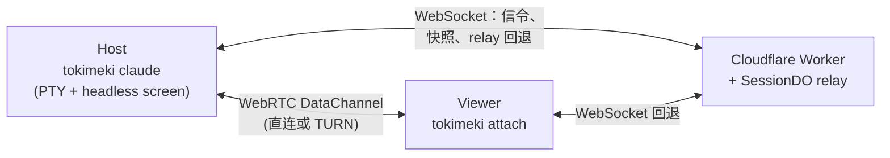

<div align="center">
  
  <h1>tokimeki</h1>
  <p><strong>跨机器共享实时终端会话，不需要屏幕共享。</strong></p>
  <p>一端用 PTY 托管 Claude Code、pi 或任意 TUI 程序，另一端通过 WebRTC P2P、TURN 或 Cloudflare relay 回退接入。</p>

  [](https://www.npmjs.com/package/@limccn/tokimeki)
  [](LICENSE)
  [](https://nodejs.org/)
  [](https://github.com/limccn/tokimeki/actions/workflows/ci.yml)

  [](https://deploy.workers.cloudflare.com/?url=https://github.com/limccn/tokimeki)

  [部署 relay 到 Cloudflare](https://deploy.workers.cloudflare.com/?url=https://github.com/limccn/tokimeki) · [CLI 文档](docs/cli.md) · [English](README.md)
</div>

---

## tokimeki 是什么？

tokimeki 让一台机器**托管**终端程序，另一台机器**接入**同一个实时会话。
它面向长时间运行的 TUI 工具：host 保持 PTY 存活，viewer 看到屏幕，多人共享键盘控制。

- **不是屏幕共享/远程桌面**，只传输终端字节。
- **P2P 优先，relay 兜底**：WebRTC DataChannel（直连）→ coturn TURN →
  Cloudflare TURN → Cloudflare Worker WebSocket 中继。
- **可自托管**：relay 部署到你自己的 Cloudflare 账号。
- **断线恢复**：快照 + 序号，viewer 掉线重连后恢复屏幕。
- **多 viewer**：多人接入，输入共享；host 保持固定 TUI 窗口，新 viewer 接入不会改变
  被托管程序的窗口尺寸。viewer 在自己的终端里留边显示或光标跟随裁剪。
- **只读听众**：`tokimeki attach --listen` 可观看会话，但不发送键盘输入/ACK、
  不改变尺寸、不尝试 P2P；host 周期发送全量快照。
- **可选 P2P 隧道**：`TOKIMEKI_TUNNEL=auto` 在 unreliable DataChannel 上启用
  AES-256-GCM + selective-repeat ARQ，可选 XOR 校验
  （`TOKIMEKI_TUNNEL_FEC=xor`）；失败自动回退 relay。
- **P2P 韧性**：DataChannel 分片、P2P 直发快照并回退 relay、ICE 自动刷新、
  TURN provider 一次重试。
- **任意 TUI 命令**：把可执行文件名加入 `TOKIMEKI_WINDOW_TUI`，即可
  `tokimeki <命令>`（例如 `TOKIMEKI_WINDOW_TUI=claude,pi,omp` 后运行
  `tokimeki omp`）。不在列表内的未知命令会被拒绝，避免误启动。
- **随时重新分享**：在 host 视口内按 F12 可重新打开 viewer config（banner
  滚走后仍可取回），按 `c` 复制完整 JSON；viewer 用 `TOKIMEKI_CONFIG` 接收。

## 工作方式



更深入的协议/架构说明见 [`CLAUDE.md`](CLAUDE.md) 与
[`docs/protocol.md`](docs/protocol.md)。

## 安装

需要 Node.js >= 22.12。

```bash
npm install -g @limccn/tokimeki
tokimeki --version
```

或临时运行，不全局安装：

```bash
npx @limccn/tokimeki --help
```

## 快速开始

### 1. 部署 relay

[](https://deploy.workers.cloudflare.com/?url=https://github.com/limccn/tokimeki)

使用上方按钮，或从仓库部署：

```bash
git clone https://github.com/limccn/tokimeki.git
cd tokimeki
npm install
npm run deploy
```

在 Cloudflare dashboard 或 `wrangler secret put TOKIMEKI_MASTER_TOKEN`
设置必填 secret。生成强随机值：

```bash
openssl rand -base64 32
```

relay URL 形如 `https://<worker-name>.<your-subdomain>.workers.dev`（CLI 用
`wss://...`）。自定义域、namespace token、Host JWT 验签、coturn、Cloudflare
TURN 见 [Cloudflare 部署](docs/deploy-cloudflare.md)。

### 2. Host 一个会话

```bash
export TOKIMEKI_RELAY_URL=wss://<your-relay>
export TOKIMEKI_MASTER_TOKEN=<relay-master-token>

tokimeki claude
# 或 tokimeki pi
# 或 tokimeki run -- <your-tui-command>
```

host 会打印 **session name** 和 **session token**。把这两个值给 viewer；
**不要分享 relay master token**。共享 relay 的 host 使用 `TOKIMEKI_TOKEN`
（namespace token 或 TokiAPI Host JWT）并必填 `TOKIMEKI_NAMESPACE`，见
[docs/cli.md](docs/cli.md)。

### 3. 从另一台机器接入

```bash
export TOKIMEKI_RELAY_URL=wss://<your-relay>
export TOKIMEKI_SESSION=<session-name>
export TOKIMEKI_SESSION_TOKEN=<session-token>

tokimeki attach
```

`tokimeki doctor` 用于检查本地 PTY 与 relay 配置。

## 命令总览

| 命令 | 作用 |
|---|---|
| `tokimeki claude [args...]` | 用 PTY 托管 Claude Code |
| `tokimeki pi [args...]` | 用 PTY 托管 pi |
| `tokimeki run -- <cmd...>` | 托管任意 TUI/终端程序 |
| `tokimeki attach` | 接入一个已托管会话 |
| `tokimeki attach --listen` | 只读观看（无输入、ACK 或尺寸变更） |
| `tokimeki doctor` | 检查 PTY、配置与 relay 连通性 |

完整命令/env 参考：[docs/cli.md](docs/cli.md)。

## TURN 部署

relay 可以下发 STUN/TURN 凭据。默认先用 STUN-only/Worker relay；需要更好
连通性时再加 TURN。

| `TOKIMEKI_TURN_PROVIDER` | 使用方式 |
|---|---|
| `auto`（默认） | 配了 coturn REST 就用，否则静态 TURN，再否则 Cloudflare TURN，最后 STUN-only |
| `coturn` | 自建 coturn；设置 `TOKIMEKI_COTURN_URLS` 与 secret |
| `cloudflare` | Cloudflare Realtime TURN；设置 Key ID + API token |
| `none` | 仅 STUN；Worker relay 兜底 |

TURN 变量、secret、按钮/手动部署步骤：
[docs/deploy-cloudflare.md](docs/deploy-cloudflare.md)。CLI 只使用 TURN UDP
（libjuice），URL 列表里至少保留一条 `turn:...?transport=udp`。

## 配置

所有运行时配置都通过环境变量：

- [`.env.example`](.env.example) — 完整参考。
- [docs/cli.md](docs/cli.md) — host/attach 命令与变量。
- [docs/deploy-cloudflare.md](docs/deploy-cloudflare.md) — relay vars/secrets。

常用：`TOKIMEKI_RELAY_URL`、`TOKIMEKI_MASTER_TOKEN`（仅 host）、
`TOKIMEKI_SESSION`、`TOKIMEKI_SESSION_TOKEN`、`TOKIMEKI_P2P`（`auto|off`）、
`TOKIMEKI_ICE_TRANSPORT_POLICY`（`all|relay`）。

### v1.1 配置

**只读听众**（viewer：`tokimeki attach --listen`）：

- 只接收全量 ANSI 快照，从不发送输入、resize、ACK、resync 或 P2P 信令；
  Ctrl-C 只退出本地 listener。
- `TOKIMEKI_LISTENER_SNAPSHOT_MS`（host，默认 `1000`，250–60000 ms）设置全量
  快照间隔。
- `TOKIMEKI_MAX_LISTENERS`（relay，默认 `8`）限制并发 listener 数；listener
  也计入 `TOKIMEKI_MAX_CLIENTS_PER_SESSION`。

**P2P 隧道**（host + viewer，opt-in，仅 P2P）：

| 变量 | 默认值 | 作用 |
|---|---|---|
| `TOKIMEKI_TUNNEL` | `off` | `auto` 在 unreliable/unordered DataChannel 上协商 AES-256-GCM + selective-repeat ARQ |
| `TOKIMEKI_TUNNEL_FEC` | `off` | `xor` 每 8 条数据记录发一条校验记录，可恢复恰好 1 条丢失；其他丢失仍走 ARQ |
| `TOKIMEKI_TUNNEL_SECRET` | — | 可选 >=16 字节共享密钥，把 `keyMode` 切换为 `shared-secret` |

两端都必须设置 `TOKIMEKI_TUNNEL=auto` 且 keyMode 一致。不匹配或隧道失败会回退
relay 并请求新快照，不会终止会话。默认 `session-token` keyMode 的密钥可由
relay 推导，因此只是传输加固，**不是**端到端加密；只有带外共享
`TOKIMEKI_TUNNEL_SECRET` 的 `shared-secret` 模式才可以称为 relay-blind。

**LAN 诊断与保留路由配置：**

- P2P debug 日志会输出所选候选对的 `lan=yes|no`；仅作诊断，不改变选路或
  relay 回退。
- `TOKIMEKI_ROUTE_POLICY=auto`、`TOKIMEKI_LAN_DISCOVERY=off`、
  `TOKIMEKI_LAN_FANOUT=off` 已识别但保留/默认关闭；本版本不实现 mDNS 与
  peer fan-out。

**自动 P2P 行为**（无需配置）：DataChannel 分片、P2P 直发快照并在失败时回退
relay、ICE 凭据到期前自动刷新、TURN provider 失败后重试一次再留在 relay。

## 安全与隐私

- token 走 header，不放进 URL；relay master token 只给 host。
- relay 承载终端数据时可以看到终端字节；P2P/TURN 改变传输路径，但不等于
  端到端加密。可选 TUN profile 只有两端都使用共享 `TOKIMEKI_TUNNEL_SECRET`
  时才是 relay-blind；默认 `session-token` keyMode 可被 relay 推导。
- 使用专用 relay/session；master token 泄漏时及时轮换。
- 漏洞请按 [SECURITY.md](SECURITY.md) 私下报告，不要开公开 issue。

## 文档

- [CLI 使用](docs/cli.md)
- [Cloudflare relay 部署 + TURN](docs/deploy-cloudflare.md)
- [线协议](docs/protocol.md)
- [生产部署说明](docs/deployment.md)
- [AI 助手技术指南](CLAUDE.md)
- [性能基线](docs/perf/)
- [发布指南](docs/release.md)

## 状态

`0.1.2` — 当前版本。从
[npm](https://www.npmjs.com/package/@limccn/tokimeki) 安装（同时镜像到 GitHub
Packages，见 [docs/release.md](docs/release.md)），或查看
[v0.1.2 release notes](https://github.com/limccn/tokimeki/releases/tag/v0.1.2)。
P2P 直连是尽力而为；TURN 或 Worker relay 是可靠回退。已知限制与 v1.1
功能演进见 [CHANGELOG.md](CHANGELOG.md) 与 [`CLAUDE.md`](CLAUDE.md)。

## 贡献

欢迎 issue/PR。请先读 [CONTRIBUTING.md](CONTRIBUTING.md) 与
[CODE_OF_CONDUCT.md](CODE_OF_CONDUCT.md)。

## 许可证

Apache License 2.0，见 [LICENSE](LICENSE)。
